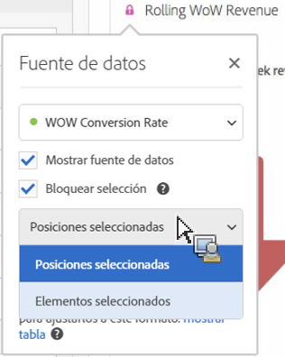

# Administración de fuentes de datos {#manage-data-sources}

>[!CONTEXTUALHELP]
>id="workspace_freeformtable_lockselection"
>title="Bloquear selección"
>abstract="Habilite esta configuración para bloquear la visualización en las posiciones o en los elementos seleccionados de la fuente de datos."

>[!CONTEXTUALHELP]
>id="workspace_freeformtable_lockselection_showtable"
>title="Mostrar tabla"
>abstract="Al seleccionar **[!UICONTROL Mostrar tabla]**, se generará un nuevo origen de datos para la visualización actual, independiente del origen de datos original."

>[!CONTEXTUALHELP]
>id="workspace_freeformtable_showtable"
>title="Mostrar tabla"
>abstract="Seleccione **[!UICONTROL Mostrar tabla]** para generar una nueva fuente de datos para la visualización actual, independiente de la fuente de datos original."

Cada visualización en Analysis Workspace se basa en una fuente de datos, normalmente una tabla de forma libre. La sincronización de visualizaciones le permite controlar qué tabla de forma libre o fuente de datos corresponde con una visualización y si la visualización permanece bloqueada a filas específicas de esa tabla.

>[!TIP]
>
>Puede saber qué visualizaciones están relacionadas por el color  situado junto al título de las visualizaciones. La coincidencia de colores significa que las visualizaciones están basadas en la misma fuente de datos.
>

<!--
**Tip:** You can tell which visualizations are related by the color of the dot next to the title. Matching colors mean that visualizations are based on the same data source.

Managing a data source lets you show the data source or lock the selection. These settings determine how the visualization changes (or doesn't change) when new data comes in.

1. [Create a project](/help/analyze/analysis-workspace/home.md) with a data table and a [visualization](/help/analyze/analysis-workspace/visualizations/freeform-analysis-visualizations.md).
1. In the data table, select the cells (data source) you want to associate with the visualization.
1. In the visualization, click the dot next to the title to bring up the **[!UICONTROL Data Source]** dialog. Select **[!UICONTROL Show Data Source]** or **[!UICONTROL Lock Selection]**.

   

   Synchronizing a visualization to a table cell creates a new (hidden) table and color-codes the synchronized visualization with that table.

>[!BEGINSHADEBOX]

See  [Data source settings](https://video.tv.adobe.com/v/328097?captions=spa&quality=12&learn=on){target="_blank"} for a demo video.

>[!ENDSHADEBOX]

-->

## Configuración de fuente de datos {#configure}

1. En Analysis Workspace, vaya a la visualización cuya fuente de datos o configuración de bloqueo desee establecer.

1. Pase el ratón sobre la visualización y luego seleccione el icono **[!UICONTROL Configuración]** .

1. Seleccione la ficha **[!UICONTROL Fuente de datos]**.

   

1. Configure cualquiera de las siguientes opciones:

   | Configuración | Descripción |
   | --- | --- |
   | **[!UICONTROL Fuente de datos]** | Seleccione la fuente de datos en la que se basa la visualización. |
   | **[!UICONTROL Visualizaciones vinculadas]** | Muestra todas las visualizaciones vinculadas a la fuente de datos (tabla de forma libre). |
   | **[!UICONTROL Mostrar fuente de datos]** | Muestre u oculte la fuente de datos (tabla de forma libre) que corresponde a la visualización. |
   | **[!UICONTROL Bloquear selección]** | Bloquee la visualización en las filas seleccionadas actualmente en el origen de datos y, a continuación, seleccione **[!UICONTROL Posiciones seleccionadas]** o **[!UICONTROL Elementos seleccionados]**. Ver [Bloquear selección](#lock-selection). |

## Bloquear selección {#lock-selection}

Bloquear la selección mantiene una visualización centrada en las filas seleccionadas en su origen de datos, incluso cuando cambia la tabla. Por ejemplo, la tabla cambia al ordenarla o filtrarla, cambiar su intervalo de fechas o aplicar un segmento. Una visualización bloqueada muestra  junto a su título.

Si los segmentos, dimensiones o métricas de la fuente de datos cambian y los datos bloqueados ya no están visibles, seleccione **[!UICONTROL Mostrar tabla]** para generar una nueva fuente de datos para la visualización, independiente de la fuente de datos original.

Cuando bloquee la selección, elija una de las siguientes opciones:

| Opción | Descripción |
| --- | --- |
| **[!UICONTROL Posiciones seleccionadas]** | Bloquea la visualización en las **posiciones** de las filas seleccionadas en el origen de datos. Estas posiciones se siguen visualizando, incluso si cambian los elementos que contienen. Por ejemplo, seleccione esta opción para mostrar siempre los cinco nombres de campaña principales en la fuente de datos, independientemente de qué campañas sean.  Si bloquea las filas de desglose y esas filas ya no están en la tabla, la visualización no se mostrará. Para volver a mostrarla, actualice la tabla (por ejemplo, su intervalo de fechas, segmentos o filtros) o actualice la selección de bloqueo. |
| **[!UICONTROL Elementos seleccionados]** | Bloquea la visualización de los **elementos** específicos seleccionados en el origen de datos. Estos elementos se siguen visualizando, incluso si cambia su clasificación en la tabla. Por ejemplo, seleccione esta opción para mostrar siempre los mismos cinco nombres de campaña, independientemente de su clasificación. |
